<div align="center">


# DDM32 Plus

**Open-source firmware for the Baofeng DM-32UV, Turkish first, English too.**
P25, DMR, YSF, NXDN, dPMR, APRS, an offline map of Turkey, satellite tracking and more.

**d0ukan · TA2DOU**

[](LICENSING.md)
[](https://github.com/tylerwatt12/Open25-DM32)
[](https://github.com/d0ukan/DDM32-Plus/releases/tag/v1.2.1)

[Türkçe](README.md) · **English**

</div>

> [!CAUTION]
> **Read this first.** DDM32 Plus is unofficial, experimental software. It is not affiliated with Baofeng,
> RadioFoundry or Open25-DM32.
>
> - Flashing firmware **can brick your radio**, erase calibration and channels, and void your warranty.
> - The software comes **"as is", with no warranty**. **All risk and responsibility are yours.** The authors
>   (d0ukan / TA2DOU) accept no liability for any malfunction, damage or data loss.
> - Transmitting is legal **only with a licence, on authorised frequencies**. Do not rely on it for emergency
>   communication.
> - Make a **full backup** before flashing (the programmer does this for you).
>
> By using this software you accept these terms. If you do not, do not use it.

## What is it?

Replacement firmware for the DM-32UV handheld. It adds many digital modes including P25, a map, a repeater list,
satellite tracking and dozens of tools. The radio runs in Turkish by default; English can be chosen.

- **Latest release:** [v1.2.1](https://github.com/d0ukan/DDM32-Plus/releases/tag/v1.2.1) (2026-11-26), programmer 3.2.0.
- **How well tested:** a stable line since v1.0.0. Every feature passes host tests, but **many changes after 1.0.2 have
  not yet been fully tried on a radio**. [CHANGELOG.md](CHANGELOG.md) says per release what ran on a radio; the radio
  test list is [`docs/plus-radio-test.md`](docs/plus-radio-test.md).

## Installing (Windows 10/11)

1. From the [latest release](https://github.com/d0ukan/DDM32-Plus/releases/latest) download **only**
   `DDM32Plus-Setup-<version>.exe` and run it. The other files are for the program itself.
   If Windows warns about an unknown publisher: **More info → Run anyway**.
2. Start the program and pick **English**.
3. Connect the cable (CH340), press **Update the radio** and follow the steps. The program backs up first, shows what
   will change and tells you when to switch the radio off and on.

Backups stay in the program's `backups` folder, also after an update or uninstall. The program can also go back to an
earlier version or to the radio's original firmware.

More: the programmer [`rust/README.md`](rust/README.md) (source: [`rust/`](rust/)), the retired Windows program
[`win/README.md`](win/README.md) and [`win/docs/kullanim.md`](win/docs/kullanim.md), the old Python program
[`pc/`](pc/) (its backups in `%LOCALAPPDATA%\DDM32Plus` are found by the new program).

## What's in it?

**Modes**

| Mode | Receive | Transmit |
| --- | :---: | :---: |
| FM / AM | ✅ | ✅ FM |
| DMR | ✅ | ✅ |
| P25 Phase 1 | ✅ | ✅ |
| YSF (C4FM) | ✅ | ⚙️ VW (off by default) |
| NXDN48 | ✅ | — |
| dPMR | ✅ | — |

**Listening**
- Watch 2–6 channels at once (rows A–F on Home).
- Every mode in the VFO: type a frequency, pick the mode.
- Fast channel scan, priority channel, P25 / DMR / all-digital search, spectrum.
- P25 NAC in hex and decimal, the received NAC on Home, RX group lists.

**Map and position**
- Offline map of Turkey: 81 provinces, 973 districts, 252 repeaters, airfields, APRS stations.
- Auto repeater scan and auto airfield scan (1.2.0).
- APRS send / receive, messages, SOS, GPS Go-To, Sun & Moon.
- Satellites and the ISS: pass times, alarm, Doppler-corrected tracking, sky plot.

**Tools**
- DOTA Transfer: send channels to another DDM32 Plus radio over the air (beta).
- Cross-band relay, last calls, air band watch, tone finder, DTMF, CW, POCSAG, ACARS, SSTV receive, MMDVM hotspot and
  more.
- Hold keys: hold a digit on Home to open a tool you choose (`4` = ISS).

Radio user guide (Turkish): [`docs/kullanim-telsiz.md`](docs/kullanim-telsiz.md).
All technical details: [`docs/plus.md`](docs/plus.md).

<details>
<summary><b>Screenshots</b> (host simulator, made-up data, English UI)</summary>

| Multi-watch | A call on C |
| :---: | :---: |
| 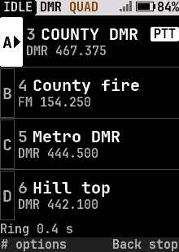 | 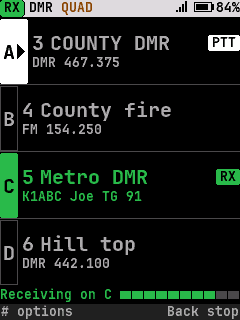 |

| P25 call with NAC | P25 RX group list | P25 search | All-digital search |
| :---: | :---: | :---: | :---: |
| 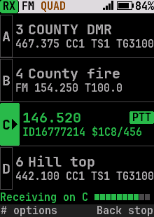 | 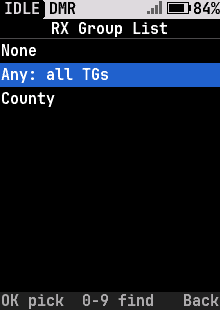 | 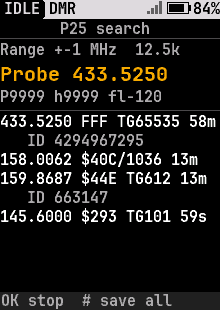 | 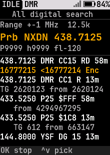 |

| APRS on the map | Track | Repeater pick |
| :---: | :---: | :---: |
|  |  |  |

| ISS page | Sky plot | Sun & Moon |
| :---: | :---: | :---: |
| 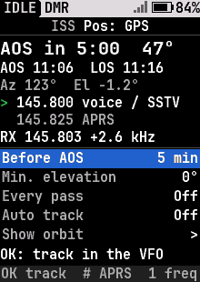 | 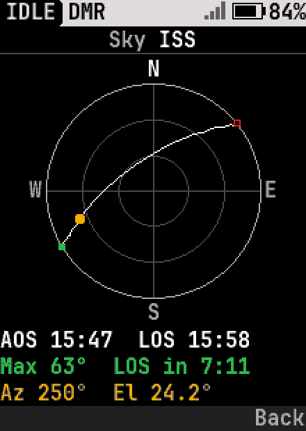 | 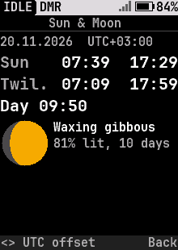 |

| Cross-band (DMR) | Cross-band (P25 / NXDN) | Pick from a zone | Segments free |
| :---: | :---: | :---: | :---: |
| 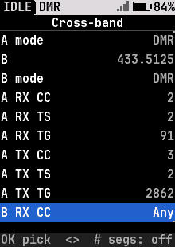 | 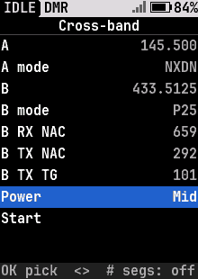 | 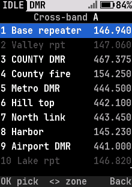 | 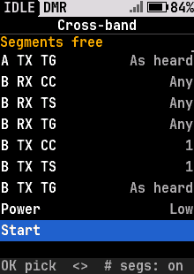 |

| Form (top) | The question | Listening on A | Sending on B |
| :---: | :---: | :---: | :---: |
| 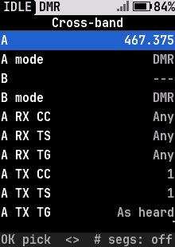 | 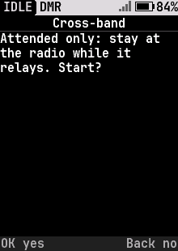 | 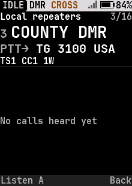 | 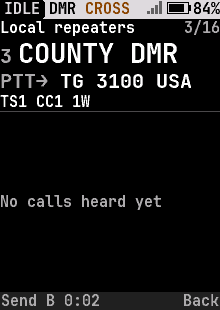 |

| Tools | Tools, more icons | Settings > Keys | Hold-key hint |
| :---: | :---: | :---: | :---: |
| 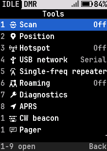 | 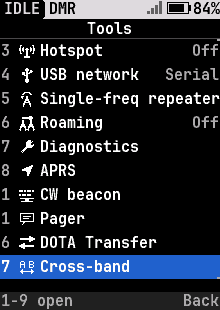 | 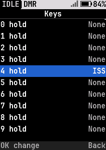 | 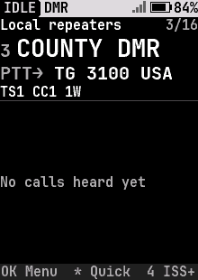 |

| Airfields | Marine VHF |
| :---: | :---: |
|  | 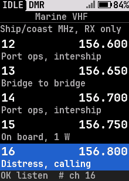 |

| Last calls | APRS station | Data packs | DOTA frequency |
| :---: | :---: | :---: | :---: |
|  |  |  |  |

| Search range | Delete channel | NAC in decimal |
| :---: | :---: | :---: |
|  |  |  |

</details>

## Coming next

These are **plans, not promises**; order and dates may change.

- **Talk through the ISS repeater**: a 437.800 repeater choice on the ISS page (listen 437.800, talk 145.990, Doppler
  corrected). In progress.
- **Faster P25 search**: recognise P25 in software to cut the wait per frequency.
- **Repeater list**: NXDN repeaters, single slot and colour code for DMR repeaters.
- **Two-radio tests** of DOTA Transfer and Cross-band.
- **Programmer**: Linux and macOS packages.
- **Real radio photos**, and full radio tests of the changes since 1.0.2.

## Where it comes from

```
RadioFoundry (MIT)  ──►  Open25-DM32 Classic r13 (MIT)  ──►  DDM32 Plus (GPL-3.0-or-later)
```

DDM32 Plus is an independent fork, **not** an official RadioFoundry or Open25-DM32 release. Report problems
[here](https://github.com/d0ukan/DDM32-Plus/issues), not upstream. The upstream README:
[`docs/UPSTREAM-README.md`](docs/UPSTREAM-README.md).

## Building it yourself

Follow upstream's [`BUILD.md`](BUILD.md) (csky-elf toolchain), then:

```sh
python3 tools/build_radiofoundry.py --plus --public --stack-check --verify-rebuild
make test
```

## Licence and credits

- Upstream files are **MIT**; DDM32 Plus additions and the firmware image are **GPL-3.0-or-later**:
  [`LICENSING.md`](LICENSING.md).
- Third-party code and data: [`THIRD_PARTY.md`](THIRD_PARTY.md) (RadioFoundry, Open25-DM32, FreeRTOS, DM32-nxdn-p25,
  MMDVMHost, dsdcc, Natural Earth, GeoNames, OurAirports, RadioID.net, TRAC, CelesTrak).
- Many thanks to the RadioFoundry and Open25-DM32 authors, whose work this is built on.
