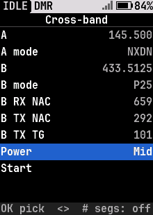
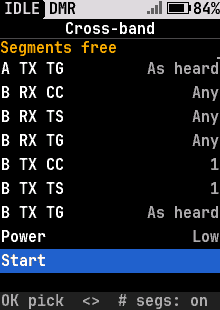

<div align="center">


# DDM32 Plus

**Baofeng DM-32UV için Türkçe, açık kaynak firmware.**
P25, DMR, YSF, NXDN, dPMR, APRS, çevrimdışı Türkiye haritası, uydu takibi ve daha fazlası.

**d0ukan · TA2DOU**

[](LICENSING.md)
[](https://github.com/tylerwatt12/Open25-DM32)
[](https://github.com/d0ukan/DDM32-Plus/releases/tag/v1.2.1)

**Türkçe** · [English](README.en.md)

</div>

> [!CAUTION]
> **Önce okuyun.** DDM32 Plus resmî olmayan, deneysel bir yazılımdır; Baofeng, RadioFoundry veya Open25-DM32 ile
> bağlantısı yoktur.
>
> - Firmware yüklemek telsizi **bozabilir**, kalibrasyonu ve kanalları silebilir, garantiyi bitirebilir.
> - Yazılım **"olduğu gibi"** verilir, hiçbir garanti yoktur. **Tüm risk ve sorumluluk sizindir.** Geliştiriciler
>   (d0ukan / TA2DOU) hiçbir arıza, hasar veya veri kaybından sorumlu değildir.
> - Yayın (TX) yalnızca **lisansla ve izinli frekanslarda** yasaldır. Acil durum haberleşmesi için bu yazılıma
>   güvenmeyin.
> - Yüklemeden önce **tam yedek** alın (programlayıcı bunu kendisi yapar).
>
> Bu yazılımı kullanan, bu koşulları kabul etmiş sayılır. Kabul etmiyorsanız kullanmayın.

## Bu nedir?

DM-32UV telsizinin içindeki yazılımın yerine geçen, baştan sona Türkçe bir firmware. Telsize P25 dahil birçok dijital
mod, harita, röle listesi, uydu takibi ve onlarca araç ekler. İngilizce arayüz de seçilebilir.

- **Son sürüm:** [v1.2.1](https://github.com/d0ukan/DDM32-Plus/releases/tag/v1.2.1) (2026-11-26), programlayıcı 3.2.0.
- **Ne kadar denendi:** v1.0.0'dan beri kararlı sürüm. Her özellik bilgisayarda testlerden geçer, ama **1.0.2'den
  sonraki birçok yenilik telsizde henüz tam denenmedi**. Hangi sürümde neyin telsizde denendiği
  [CHANGELOG.md](CHANGELOG.md) içinde; telsiz test listesi [`docs/plus-radio-test.md`](docs/plus-radio-test.md).

## Kurulum (Windows 10/11)

1. [Son sürüm sayfasından](https://github.com/d0ukan/DDM32-Plus/releases/latest) **yalnızca**
   `DDM32Plus-Setup-<sürüm>.exe` dosyasını indirip çalıştırın. Diğer dosyalar programın kendisi içindir.
   Windows "bilinmeyen yayıncı" derse: **Ek bilgi → Yine de çalıştır**.
2. Programı açın, **Türkçe** seçin.
3. Kabloyu (CH340) takın, **Telsizi güncelle**'ye basın ve adımları izleyin. Program önce yedek alır, neyin
   değişeceğini gösterir, telsizi ne zaman kapatıp açacağınızı söyler.

Yedekler programın `backups` klasöründe kalır; güncellemede ve kaldırmada silinmez. Program istenirse eski sürüme
veya telsizin orijinal yazılımına da geri döner.

Daha fazlası: programlayıcı [`rust/README.md`](rust/README.md) (kaynak: [`rust/`](rust/)), eski Windows programı
[`win/README.md`](win/README.md) ve [`win/docs/kullanim.md`](win/docs/kullanim.md), eski Python programı
[`pc/`](pc/) (yedekleri `%LOCALAPPDATA%\DDM32Plus` içinde; yeni program da bulur).

## Neler var?

**Modlar**

| Mod | Dinleme | Konuşma |
| --- | :---: | :---: |
| FM / AM | ✅ | ✅ FM |
| DMR | ✅ | ✅ |
| P25 Faz 1 | ✅ | ✅ |
| YSF (C4FM) | ✅ | ⚙️ VW (kapalı gelir) |
| NXDN48 | ✅ | — |
| dPMR | ✅ | — |

**Dinleme**
- 2–6 kanalı aynı anda izleme (ana ekranda A–F satırları).
- VFO'da her mod: frekansı yaz, modu seç.
- Hızlı kanal tarama, öncelikli kanal, P25 / DMR / tüm dijital arama, spektrum.
- P25'te NAC hem hex hem desimal, alınan NAC ana ekranda, RX grup listeleri.

**Harita ve konum**
- Çevrimdışı Türkiye haritası: 81 il, 973 ilçe, 252 röle, havalimanları, APRS istasyonları.
- Otomatik röle taraması ve otomatik havalimanı taraması (1.2.0).
- APRS gönderme / alma, mesaj, SOS, GPS ile hedefe gitme, Güneş ve Ay.
- Uydular ve ISS: geçiş zamanı, alarm, Doppler düzeltmeli takip, gökyüzü grafiği.

**Araçlar**
- DOTA Transfer: kanalları başka bir DDM32 Plus telsize havadan gönderme (beta).
- Çapraz bant rölesi, son çağrılar, hava bandı izleme, ton bulucu, DTMF, CW, POCSAG, ACARS, SSTV alma, MMDVM
  hotspot ve daha fazlası.
- Basılı tutma tuşları: ana ekranda bir rakamı basılı tutunca seçtiğiniz araç açılır (`4` = ISS).

Telsizde kullanım kılavuzu (Türkçe): [`docs/kullanim-telsiz.md`](docs/kullanim-telsiz.md).
Tüm teknik ayrıntılar: [`docs/plus.md`](docs/plus.md).

<details>
<summary><b>Ekran görüntüleri</b> (bilgisayar simülatöründen, uydurma verilerle, İngilizce arayüz)</summary>

| Çoklu izleme | C'de bir çağrı |
| :---: | :---: |
|  |  |

| NAC'li P25 çağrısı | P25 RX grup listesi | P25 arama | Tüm dijital arama |
| :---: | :---: | :---: | :---: |
|  |  |  |  |

| Haritada APRS | İz | Röle seçimi |
| :---: | :---: | :---: |
|  |  |  |

| ISS sayfası | Gökyüzü grafiği | Güneş ve Ay |
| :---: | :---: | :---: |
|  |  |  |

| Çapraz bant (DMR) | Çapraz bant (P25 / NXDN) | Bölgeden seçim | Bölümler serbest |
| :---: | :---: | :---: | :---: |
|  |  |  |  |

| Form (üst) | Soru | A'da dinleme | B'de gönderme |
| :---: | :---: | :---: | :---: |
|  |  |  |  |

| Araçlar | Araçlar, diğer simgeler | Ayarlar > Tuşlar | Basılı tutma ipucu |
| :---: | :---: | :---: | :---: |
|  |  |  |  |

| Havalimanları | Deniz VHF |
| :---: | :---: |
|  |  |

| Son çağrılar | APRS istasyonu | Veri paketleri | DOTA frekansı |
| :---: | :---: | :---: | :---: |
|  |  |  |  |

| Arama aralığı | Kanal silme | Desimal NAC |
| :---: | :---: | :---: |
|  |  |  |

</details>

## Gelecekte

Bunlar **plan**, söz değil; sıra ve tarih değişebilir.

- **ISS rölesi üzerinden konuşma**: ISS sayfasında 437.800 röle seçeneği (dinle 437.800, konuş 145.990, Doppler
  düzeltmeli). Üzerinde çalışılıyor.
- **Daha hızlı P25 arama**: P25 sinyalini yazılımla tanıyarak frekans başına bekleme süresini kısaltmak.
- **Röle listesi**: NXDN röleleri, DMR rölelerinde tek slot ve renk kodu bilgisi.
- **İki telsizle testler**: DOTA Transfer ve Çapraz bant'ın gerçek iki telsiz arasında denenmesi.
- **Programlayıcı**: Linux ve macOS paketleri.
- **Gerçek telsiz fotoğrafları** ve 1.0.2'den sonraki yeniliklerin telsizde tam denenmesi.

## Nereden geliyor?

```
RadioFoundry (MIT)  ──►  Open25-DM32 Classic r13 (MIT)  ──►  DDM32 Plus (GPL-3.0-or-later)
```

DDM32 Plus bağımsız bir çatallamadır (fork); RadioFoundry veya Open25-DM32'nin resmî sürümü **değildir**. Sorunları
upstream projelere değil, [buraya](https://github.com/d0ukan/DDM32-Plus/issues) yazın. Upstream'in kendi README'si:
[`docs/UPSTREAM-README.md`](docs/UPSTREAM-README.md).

## Kendiniz derlemek isterseniz

Upstream'in [`BUILD.md`](BUILD.md) adımları (csky-elf araç zinciri), sonra:

```sh
python3 tools/build_radiofoundry.py --plus --public --stack-check --verify-rebuild
make test
```

## Lisans ve teşekkür

- Upstream dosyaları **MIT**, DDM32 Plus eklemeleri ve firmware imajı **GPL-3.0-or-later**:
  [`LICENSING.md`](LICENSING.md).
- Üçüncü taraf kod ve veriler: [`THIRD_PARTY.md`](THIRD_PARTY.md) (RadioFoundry, Open25-DM32, FreeRTOS,
  DM32-nxdn-p25, MMDVMHost, dsdcc, Natural Earth, GeoNames, OurAirports, RadioID.net, TRAC, CelesTrak).
- Bu çalışmanın temelini oluşturan RadioFoundry ve Open25-DM32 geliştiricilerine teşekkürler.
