<div align="center">


# DDM32 Plus

**Turkish-first open firmware for the Baofeng DM-32UV — P25, DMR, YSF, NXDN, dPMR, APRS, maps and much more.**

by **d0ukan · TA2DOU**

[](LICENSING.md)
[](https://github.com/tylerwatt12/Open25-DM32)
[](https://github.com/d0ukan/DDM32-Plus/releases/tag/v1.2.1)

[Türkçe README](README.tr.md)

</div>

> [!CAUTION]
> ## ⚠️ DISCLAIMER — READ BEFORE USING
>
> DDM32 Plus is **unofficial, experimental** firmware and programming software. It is not affiliated with or
> endorsed by Baofeng, RadioFoundry or Open25-DM32.
>
> - Flashing firmware **can permanently brick your radio**, erase calibration and channel data, and void your warranty.
> - This software is provided **"AS IS", without warranty of any kind**, express or implied, including merchantability
>   or fitness for a particular purpose.
> - **You flash, install and use it entirely at your own risk and responsibility.** The authors (d0ukan / TA2DOU) and
>   contributors accept **no liability for any malfunction, damage, data loss, or direct or indirect loss** to radios,
>   computers or any other equipment.
> - Transmitting is legal **only with a valid licence on authorised frequencies**; complying with radio regulations is
>   solely your responsibility. **Do not rely** on this firmware for emergency or safety-of-life communication.
> - Always make and keep a **full backup** before flashing.
>
> **By downloading, installing or using this software you confirm that you have read, understood and accepted these
> terms. If you do not accept them, do not use it.**

## Status

DDM32 Plus has been a **stable** release line since **v1.0.0** (2026-11-23). The latest published release is
**[v1.2.1](https://github.com/d0ukan/DDM32-Plus/releases/tag/v1.2.1)** (2026-11-26), with the programmer **3.2.0**
(Rust, Windows setup; Linux and macOS packages follow; source in [`rust/`](rust/)). The C# Windows programmer 2.0.0
is retired. **1.1.0 moves the map, the repeater list and the airfields into a map pack on the data chip** (about 40 KB
of program flash freed); **update the programmer to 3.2.0 first**, it writes the map pack. **1.2.0 adds the auto
airfield scan and the auto repeater scan** (Tools > Air scan / Repeater scan); **1.2.1 makes Menu > Channels faster**. Features marked
"(1.0.2)" - "(1.2.1)" below came with that version; **1.0.2 - 1.2.1 were published before a full radio test** (from 1.0.3 the ISS hold key, the search screen and Sun & Moon were seen working on
the radio; the rest is host-tested only).

Every feature below is built and covered by host tests (a simulator of the radio's screens, radio core and modems), but
**many features have not yet been tried on the air**: the CHANGELOG says, release by release, what has run on a radio
and what is host-tested only (v1.0.2 and later: host-tested only). Radio test notes live in
[`docs/plus-radio-test.md`](docs/plus-radio-test.md); changes per release in [CHANGELOG.md](CHANGELOG.md).

## Where it comes from

```
RadioFoundry (MIT)  ──►  Open25-DM32 Classic r13 (MIT)  ──►  DDM32 Plus (GPL-3.0-or-later)
open firmware base        P25, IMBE, native modem, CPS        this fork: everything below
```

DDM32 Plus is an independent fork. It is **not** an official RadioFoundry or Open25-DM32 release. Please report
DDM32 Plus problems [here](https://github.com/d0ukan/DDM32-Plus/issues), not to the upstream projects. The upstream
README is kept in [`docs/UPSTREAM-README.md`](docs/UPSTREAM-README.md).

## Features

### Digital and analogue modes

| Mode | Receive | Transmit | Notes |
| --- | :---: | :---: | --- |
| FM / AM | ✅ | ✅ FM | AM on the air band and (if the receiver allows it) elsewhere; tone finder for CTCSS/DCS |
| DMR Tier I/II | ✅ | ✅ | Any colour code / timeslot / talkgroup, roaming, SMS, emergency, Tier III trunk following (receive) |
| P25 Phase 1 | ✅ | ✅ | NAC in hex **and decimal**, Any NAC/TG, split RX/TX NAC, RX group lists (1.0.3), the received NAC shown on Home, emergency and unit-to-unit calls, trunk following |
| YSF (C4FM) | ✅ DN + VW | ⚙️ VW (off by default) | callsigns from the header |
| NXDN48 | ✅ | — | |
| dPMR | ✅ | — | |

### Listening

- **Frequency on Home** under the channel (RX/TX for repeaters), and Large text up to twice as big.
- **Multi-watch 2–6 channels**: rows A–F on Home, each letter a channel **or its own VFO** in any mode.
- **Every mode in the VFO**: type a frequency and pick FM / DMR / P25 / YSF / NXDN / dPMR / AM with all parameters,
  including Any.
- **Zone scan with P25** that catches short calls, **priority channel**, **temporary skip**. Quiet channels are left
  early (a **faster channel scan**, v1.0.1; held `0` while scanning switches back to the classic dwell), and the P25
  receiver's false carrier on an empty channel is learned instead of held (1.0.3 / 1.0.4).
- **P25 RX group lists**: a P25 channel picks one of the codeplug's RX group lists (None, Any, or a list) (1.0.3).
- **The received NAC on Home** as `$hex/dec` (for example `$1C8/456`) in the caller line and in dual and multi-watch
  panes, also on a channel with NAC Any (1.0.4).
- P25 search, DMR search, all-digital search, spectrum and close call, fox hunt.

| Multi-watch | A call on C |
| :---: | :---: |
| 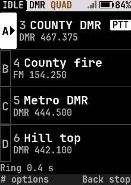 | 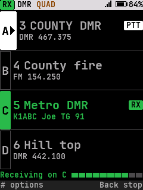 |

| A P25 call on a watch row, with its NAC | P25 RX group list | P25 search | All-digital search |
| :---: | :---: | :---: | :---: |
| 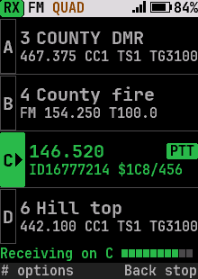 | 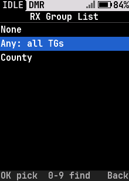 | 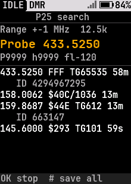 | 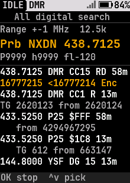 |

### Maps and position

- Offline **Turkey map**: 81 provinces, **973 districts**, repeaters, APRS stations heard, your track.
- **Repeaters**: 252 built in (DMR and FM), grouped by province, nearest first, one key tunes the VFO;
  **auto repeater** suggests a nearer one while you travel.
- **APRS** receive and transmit, messages, SOS; GPS, Go-To with waypoints, **Sun & Moon** (rise, set, twilight, the
  moon's phase).
- **Satellites**: passes, pass alarm, Doppler-corrected tracking, a **sky plot** of the pass. **Tools > ISS** has its
  own page (countdown, AOS / LOS, the voice and APRS downlinks, auto track, "Show orbit"); on Home a held `4` starts ISS
  tracking, or opens that page when no pass is near (1.0.3; a hold key, see Tools below).
- **Airfields** (nearest first, AM tune) and a **marine VHF** table (receive only).

| APRS on the map | Track | Repeater pick |
| :---: | :---: | :---: |
|  |  |  |

| ISS page | Sky plot | Sun & Moon |
| :---: | :---: | :---: |
| 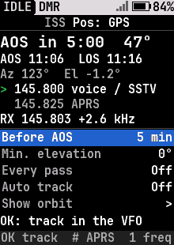 | 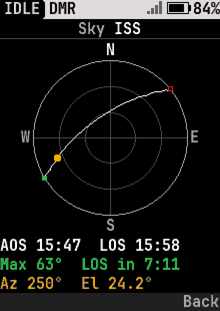 | 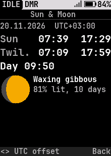 |

### Tools

**DOTA Transfer**: send channels, zones, everything, or a data pack to another DDM32 Plus radio over FM or DMR (beta,
not yet tried between two radios). **Last calls** of every mode and watched channel, **Cross-band** (below), **air
watch** (an airfield's frequencies at once), a **3D waterfall**, **Mic-E** beacons, an **APRS station page** with Go-To
and the map, **data packs** (RadioID names, air band frequencies), faster P25 / DMR search with your own range and step,
**delete channel**. Tone finder (CTCSS/DCS), DTMF / SelCall decoder, CW decoder and practice, pager (POCSAG) and ACARS,
SSTV receive, CW beacon, lone worker (sound, DMR emergency or APRS SOS), call history with QSO marks, MMDVM hotspot over the programming cable, FM caller ID, signal quality. Each Tools entry has an icon of its
own (new for DOTA Transfer, Cross-band, CW decoder and SOS key in 1.0.3). Settings > About and the boot screen carry
the byline "d0ukan, TA2DOU" (the screenshots below come from the host simulator, which shows upstream's About page).

**Hold keys** (1.0.4): on Home a held digit `0`-`9` opens a tool you pick in **Settings > Keys** (rows "0 hold" ...
"9 hold"; None or any Tools entry). `4` is the ISS by default; Home's hint row names the first key set ("4 ISS", with a
"+" when more are set). In the VFO a held digit still types it.

#### Cross-band

**Tools > Cross-band** is an attended store-and-forward relay between two frequencies, **A and B, which may be on
different bands**: what is heard on one side is recorded whole and then sent on the other. Each side has its own mode;
the pairs are **DMR -> DMR, NXDN -> DMR, DMR / NXDN -> FM and P25 -> P25** (1.0.3) and **FM -> DMR** (1.0.6; FM is
heard only when the DMR side has a TX TG). An FM side has **RX Tone** and **TX Tone** rows (CTCSS / DCS, 1.0.6). Every
side has its own filters and
TX values: DMR **RX CC / TS / TG** (default Any) and **TX CC / TS / TG**, P25 **RX NAC** (default Any) and **TX NAC**
(default 293; a P25 relay sends with the side's TX NAC, not the one it heard). The radio asks before it starts,
locks while it runs, shows **CROSS** on every screen and sends a CW ID. Outside the amateur bands and PMR446 it refuses;
`#` on the form also frees the satellite, repeater and APRS segments (until the radio is switched off; the hint bar
shows "# segs: on"). The per-side modes and values came with 1.0.3 (before it, DMR only) and are host-tested only.

| Form (DMR sides) | Form (modes P25 / NXDN) | Pick from a zone | Segments free |
| :---: | :---: | :---: | :---: |
| 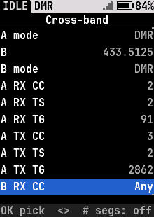 |  | 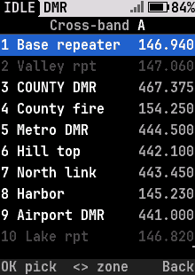 |  |

| Form (top) | The question | Listening on A | Sending on B |
| :---: | :---: | :---: | :---: |
| 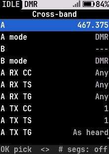 | 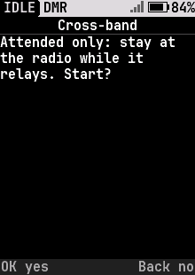 | 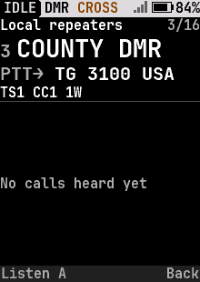 | 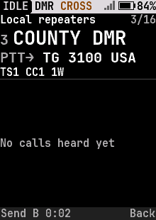 |

| Tools | Tools, more icons | Settings > Keys | Home with a hold-key hint |
| :---: | :---: | :---: | :---: |
| 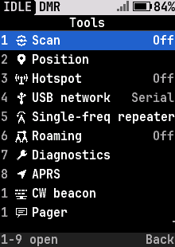 | 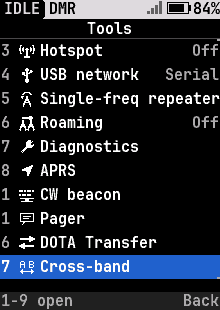 | 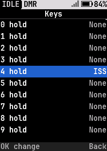 | 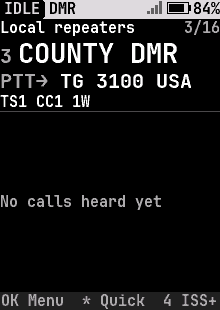 |

| Airfields | Marine VHF |
| :---: | :---: |
|  | 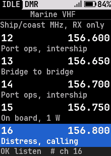 |

| Last calls | APRS station | Data packs in About | DOTA frequency |
| :---: | :---: | :---: | :---: |
|  |  |  |  |

| Search range | Delete channel | NAC in decimal |
| :---: | :---: | :---: |
|  |  |  |

*Screenshots come from the firmware's own screen simulator with made-up data (English UI; the radio runs Turkish by
default; the host UI tests write them). Photos from a real radio will follow.*

### Turkish first

The whole interface is translated to Turkish (and remains available in English). Technical names (RX, TX, NAC, VFO,
…) stay as they are.

A short Turkish guide for using the radio (keys, zones and channels, multi-watch, modes, search, map / APRS /
airfields, DOTA, data packs, cross-band, diagnostics): [`docs/kullanim-telsiz.md`](docs/kullanim-telsiz.md).

## Installing

Use the **DDM32 Plus programmer** for Windows 10/11 (nothing else to install):

1. Download **only** `DDM32Plus-Setup-<version>.exe` from the [latest release](https://github.com/d0ukan/DDM32-Plus/releases/latest)
   (the other files there are for the program itself; it installs over the retired C# programmer 2.0.0) and run it. It installs for your user only (no administrator prompt), with a Start menu and desktop
   shortcut. Windows may warn about an unknown publisher (the program is not code-signed yet): **More info → Run
   anyway**.
2. On first start pick **Türkçe** or **English**.
3. Connect the programming cable (CH340), go to **Update the radio** and follow the steps; the program tells you when
   to switch the radio off and on. Your backups stay in the program's `backups` folder, also after an update or an
   uninstall.

The programmer backs the radio up (or reuses your last backup of the same radio), shows exactly what will change,
installs (also from the radio's stock firmware, using the radio's own codec), goes back to the previous version or to
stock from your own backup, checks signed updates, updates itself, and loads **data packs** (RadioID names, air band
frequencies) that it builds on your PC from files you download yourself. It also has a radio health page, a read-only
live panel, a search log and "my channels". Guides: [`win/README.md`](win/README.md) and the Turkish user guide
[`win/docs/kullanim.md`](win/docs/kullanim.md) (Windows, C#), [`rust/README.md`](rust/README.md) (cross-platform,
Rust); the Turkish guide for the radio itself is [`docs/kullanim-telsiz.md`](docs/kullanim-telsiz.md). Everything
**at your own risk** (see the disclaimer above).

The older Python programmer ([`pc/`](pc/)) still works; existing backups in `%LOCALAPPDATA%\DDM32Plus` (or
`DDM25Plus`) are found by the new programs.

## In development

- Two-radio tests of DOTA Transfer (channels and data packs) and of Cross-band, and on-the-air runs of 1.0.2 - 1.0.4
  (the radio test rows are in [`docs/plus-radio-test.md`](docs/plus-radio-test.md)).
- Linux (AppImage, .deb) and macOS packages of the cross-platform programmer.

## Building

The build follows upstream's [`BUILD.md`](BUILD.md) (csky-elf toolchain, pinned sources). DDM32 Plus adds:

```sh
python3 tools/build_radiofoundry.py --plus --stack-check --verify-rebuild           # DDM32 Plus
python3 tools/build_radiofoundry.py --plus --public --stack-check --verify-rebuild  # the same image (the RadioID database is a data pack)
make test
```

Feature notes, RAM budget and design decisions: [`docs/plus.md`](docs/plus.md).

## Licence and credits

- Upstream files (RadioFoundry, Open25-DM32) are **MIT**; DDM32 Plus additions are **GPL-3.0-or-later**; a DDM32
  Plus firmware image is distributed under GPL-3.0-or-later. Details: [`LICENSING.md`](LICENSING.md).
- Third-party code and data, with their terms: [`THIRD_PARTY.md`](THIRD_PARTY.md) — RadioFoundry, Open25-DM32,
  FreeRTOS, DM32-nxdn-p25, MMDVMHost, dsdcc, Natural Earth, GeoNames (CC BY 4.0), OurAirports, RadioID.net, TRAC,
  CelesTrak.
- Many thanks to the RadioFoundry and Open25-DM32 authors, whose work this is built on.
