<div align="center">


# DDM32 Plus

**Baofeng DM-32UV için Türkçe öncelikli açık firmware — P25, DMR, YSF, NXDN, dPMR, APRS, harita ve çok daha fazlası.**

**d0ukan · TA2DOU**

[](LICENSING.md)
[](https://github.com/tylerwatt12/Open25-DM32)
[](https://github.com/d0ukan/DDM32-Plus/releases/tag/v1.0.6)

[English README](README.md)

</div>

> [!CAUTION]
> ## ⚠️ SORUMLULUK REDDİ — OKUMADAN KULLANMAYIN
>
> DDM32 Plus **resmî olmayan, deneysel** bir firmware ve programlama aracıdır. Baofeng, RadioFoundry veya Open25-DM32
> ile bağlantılı değildir ve onlar tarafından onaylanmamıştır.
>
> - Telsizinize firmware yüklemek (flashlamak) **telsizinizi kalıcı olarak kullanılamaz hâle getirebilir**,
>   kalibrasyon verilerini, kanal kayıtlarını ve garantinizi kaybettirebilir.
> - Bu yazılım **"OLDUĞU GİBİ"**, hiçbir açık veya örtülü garanti olmaksızın sunulur. Çalışacağı, hatasız olduğu
>   veya belirli bir amaca uygun olduğu garanti **edilmez**.
> - Yükleme, kurulum ve kullanımın **tüm riski ve sorumluluğu size aittir.** Geliştiriciler (d0ukan / TA2DOU) ve
>   katkıda bulunanlar; telsizde, bilgisayarda veya başka ekipmanda oluşabilecek **hiçbir arıza, hasar, veri kaybı,
>   doğrudan veya dolaylı zarardan sorumlu tutulamaz.**
> - Yayın yapmak (TX) yalnızca **geçerli bir lisansla ve izinli frekanslarda** yasaldır. Telsiz mevzuatına uymak
>   tamamen kullanıcının sorumluluğundadır. Acil durum ve can güvenliği haberleşmesi için bu firmware'e
>   **güvenmeyin.**
> - Yüklemeden önce mutlaka **tam yedek** alın ve yedeği güvenli bir yerde saklayın.
>
> **Bu yazılımı indirerek, yükleyerek veya kullanarak bu koşulları okuduğunuzu, anladığınızı ve kabul ettiğinizi
> beyan etmiş olursunuz. Kabul etmiyorsanız kullanmayın.**

## Durum

DDM32 Plus **v1.0.0** (2026-11-23) ile **kararlı** sürüm hattındadır. Yayımlanmış en son sürüm
**[v1.0.6](https://github.com/d0ukan/DDM32-Plus/releases/tag/v1.0.6)** (2026-11-26); programlayıcı **3.1.0** ile
birlikte (Rust, Windows kurulumu; Linux ve macOS paketleri sonra; kaynak [`rust/`](rust/) içinde). C# Windows programı
2.0.0 emekliye ayrıldı. 1.0.5, Araçlar > Saat'i ve pil grafiğini program flash'ında yer açmak için çıkardı.
Aşağıda "(1.0.2)" - "(1.0.6)" yazan özellikler o sürümle geldi; **1.0.2 - 1.0.6
telsizde tam denenmeden yayımlandı** (1.0.3'ten ISS basılı tuşu, arama ekranı ve Güneş & Ay telsizde çalışırken
görüldü; gerisi yalnızca bilgisayarda test edildi).

Aşağıdaki her özellik yazıldı ve bilgisayarda testlerden geçti (telsizin ekran, radyo çekirdeği ve modemlerinin
simülatörü), ama **birçok özellik henüz havada denenmedi**: CHANGELOG her sürüm için hangi parçanın telsizde
çalıştığını, hangisinin yalnızca bilgisayarda test edildiğini söyler (v1.0.2 ve sonrası: yalnızca bilgisayarda test
edildi). Telsiz test notları: [`docs/plus-radio-test.md`](docs/plus-radio-test.md); sürüm değişiklikleri:
[CHANGELOG.md](CHANGELOG.md).

## Nereden geliyor

```
RadioFoundry (MIT)  ──►  Open25-DM32 Classic r13 (MIT)  ──►  DDM32 Plus (GPL-3.0-or-later)
açık firmware temeli      P25, IMBE, native modem, CPS        bu fork: aşağıdaki her şey
```

DDM32 Plus bağımsız bir fork'tur; RadioFoundry'nin veya Open25-DM32'nin resmî bir sürümü **değildir**. DDM32 Plus
ile ilgili sorunları upstream projelere değil, [buraya](https://github.com/d0ukan/DDM32-Plus/issues) bildirin.
Upstream'in README'si [`docs/UPSTREAM-README.md`](docs/UPSTREAM-README.md) içinde duruyor.

## Özellikler

### Dijital ve analog modlar

| Mod | Alma | Gönderme | Notlar |
| --- | :---: | :---: | --- |
| FM / AM | ✅ | ✅ FM | AM air band'de ve alıcının izin verdiği diğer frekanslarda; CTCSS/DCS ton bulucu |
| DMR Tier I/II | ✅ | ✅ | Any renk kodu / slot / talkgroup, roaming, SMS, acil çağrı, Tier III trunk takibi (alma) |
| P25 Faz 1 | ✅ | ✅ | NAC hem **hex hem desimal**, Any NAC/TG, ayrı RX/TX NAC, RX grup listeleri (1.0.3), alınan NAC ana ekranda, acil ve birebir çağrılar, trunk takibi |
| YSF (C4FM) | ✅ DN + VW | ⚙️ VW (varsayılan kapalı) | başlıktan çağrı işareti |
| NXDN48 | ✅ | — | |
| dPMR | ✅ | — | |

### Dinleme

- **Ana ekranda frekans**: kanalın altında (rölelerde RX/TX), Large text iki kata kadar büyük.
- **2–6 kanal izleme**: ana ekranda A–F satırları; her harf bir kanal **ya da kendi VFO'su**, her modda.
- **VFO'da her mod**: frekansı yaz, FM / DMR / P25 / YSF / NXDN / dPMR / AM seç, Any dahil tüm ayarlarıyla.
- **P25'li zone tarama** (kısa çağrıları yakalar), **öncelikli kanal**, **geçici atlama**. Sessiz kanallar erken
  bırakılır (**daha hızlı kanal tarama**, v1.0.1; tarama sırasında basılı tutulan `0` eski bekleyişe döner); boş
  kanalda P25 alıcısının sahte taşıyıcısı tutulmak yerine öğrenilir (1.0.3 / 1.0.4).
- **P25 RX grup listeleri**: P25 kanalı, codeplug'daki RX grup listelerinden birini seçer (Yok, Tümü ya da bir liste)
  (1.0.3).
- **Alınan NAC ana ekranda** `$hex/dec` olarak (örneğin `$1C8/456`): arayan satırında ve çift / çoklu izleme
  panellerinde, NAC Any kanalda da (1.0.4).
- P25 arama, DMR arama, tüm dijital arama, spektrum ve close call, fox hunt.

| Çoklu izleme | C'de bir çağrı |
| :---: | :---: |
| 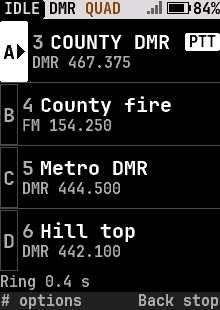 | 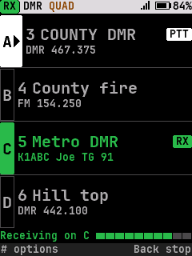 |

| İzleme satırında NAC'li P25 çağrısı | P25 RX grup listesi | P25 arama | Tüm dijital arama |
| :---: | :---: | :---: | :---: |
| 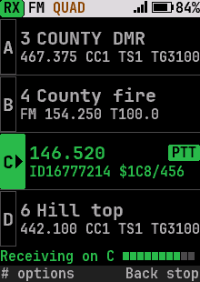 | 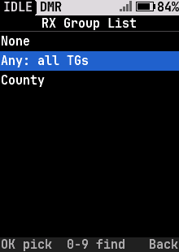 | 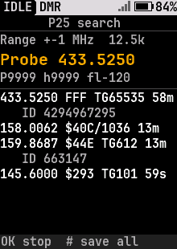 | 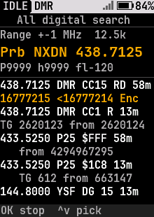 |

### Harita ve konum

- Çevrimdışı **Türkiye haritası**: 81 il, **973 ilçe**, röleler, duyulan APRS istasyonları, yürüdüğünüz iz.
- **Röleler**: 252 hazır röle (DMR ve FM), il il gruplu, en yakın önce, tek tuşla VFO'ya; **otomatik röle**
  yolculukta daha yakın röleyi önerir.
- **APRS** alma ve gönderme, mesaj, SOS; GPS, işaretli noktalarla Go-To, **Güneş ve Ay** (doğuş, batış, alaca, ayın
  evresi).
- **Uydular**: geçişler, geçiş alarmı, Doppler düzeltmeli takip, geçişin **gökyüzü grafiği**. **Araçlar > ISS**'in kendi
  sayfası var (geri sayım, AOS / LOS, ses ve APRS iniş frekansları, otomatik takip, "Yörüngeyi göster"); ana ekranda
  basılı tutulan `4`, geçiş yakınsa ISS takibini başlatır, değilse bu sayfayı açar (1.0.3; bir basılı tutma tuşu, aşağıda
  Araçlar'a bakın).
- **Havalimanları** (en yakın önce, AM ile ayar) ve **deniz VHF** tablosu (sadece alma).

| Haritada APRS | İz | Röle seçimi |
| :---: | :---: | :---: |
|  |  |  |

| ISS sayfası | Gökyüzü grafiği | Güneş ve Ay |
| :---: | :---: | :---: |
| 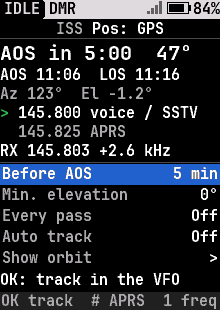 | 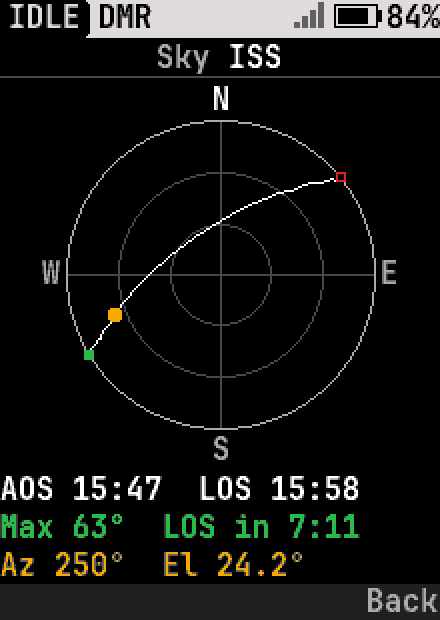 | 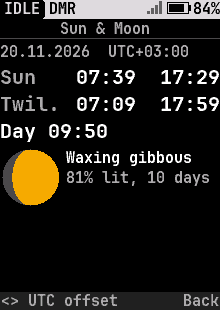 |

### Araçlar

**DOTA Transfer**: kanalları, bölgeleri, tümünü ya da bir veri paketini başka bir DDM32 Plus telsize FM veya DMR ile
gönderir (beta, henüz iki telsiz arasında denenmedi). Tüm modlarda ve izlenen kanallarda **son çağrılar**, **Çapraz
bant** (aşağıda), **hava bandı izleme** (bir meydanın frekansları birlikte), **3D şelale**, **Mic-E** beacon, Go-To ve
haritayla **APRS istasyon sayfası**, **veri paketleri** (RadioID isimleri, hava bandı frekansları), kendi aralık ve
adımınızla daha hızlı P25 / DMR arama, **kanal silme**. Ton bulucu (CTCSS/DCS), DTMF / SelCall çözücü, CW çözücü ve
pratik, pager (POCSAG) ve ACARS, SSTV alma, CW beacon, lone worker (ses, DMR acil veya APRS SOS), QSO işaretli çağrı
geçmişi, programlama kablosu üzerinden MMDVM hotspot, FM arayan kimliği, sinyal kalitesi.
Araçlar'daki her girişin kendi simgesi var (DOTA Transfer, Çapraz bant, CW çözücü ve SOS tuşu için 1.0.3'te yenilendi).
Ayarlar > Hakkında ve açılış ekranı "d0ukan, TA2DOU" imzasını taşır (aşağıdaki ekran görüntüleri, upstream'in Hakkında
sayfasını gösteren bilgisayar simülatöründen).

**Basılı tutma tuşları** (1.0.4): ana ekranda basılı tutulan `0`-`9` rakamı, **Ayarlar > Tuşlar**'dan seçtiğiniz aracı
açar ("0 uzun" ... "9 uzun" satırları; Yok ya da Araçlar'daki herhangi bir giriş). `4` varsayılan olarak ISS'tir; ana
ekranın ipucu satırı ilk ayarlı tuşu söyler ("4 ISS", birden çoksa "+"). VFO'da basılı tutulan rakam yine rakamı yazar.

#### Çapraz bant

**Araçlar > Çapraz bant**, iki frekans arasında yalnız başındayken çalışan bir kaydet-ilet rölesidir; **A ve B farklı
bantlarda olabilir**: bir tarafta duyulan konuşma bütün olarak kaydedilir, sonra diğer tarafta gönderilir. Her tarafın
kendi modu vardır; olan çiftler **DMR -> DMR, NXDN -> DMR, DMR / NXDN -> FM ve P25 -> P25** (1.0.3) ve **FM -> DMR**
(1.0.6; FM ancak DMR tarafında TX TG varsa dinlenir). FM tarafında **RX Tone** ve **TX Tone** satırları vardır
(CTCSS / DCS, 1.0.6). Her tarafın kendi
süzgeçleri ve TX değerleri var: DMR **RX CC / TS / TG** (varsayılan Tümü) ve **TX CC / TS / TG**, P25 **RX NAC**
(varsayılan Tümü) ve **TX NAC** (varsayılan 293; P25 rölesi duyduğu NAC ile değil, tarafın TX NAC'i ile gönderir).
Telsiz başlamadan sorar, çalışırken kilitlenir, her ekranda **CROSS** işareti gösterir ve CW ile kimlik verir. Amatör
bantların ve PMR446'nın dışını reddeder; formda `#` uydu, röle ve APRS bölümlerini de serbest bırakır (telsiz
kapanana kadar; ipucu satırında "# segs: on" yazar). Taraf başına modlar ve değerler 1.0.3 ile geldi (öncesinde
yalnız DMR) ve yalnızca bilgisayarda test edildi.

| Form (DMR tarafları) | Form (NXDN / P25 modları) | Bölgeden seçim | Bölümler serbest |
| :---: | :---: | :---: | :---: |
| 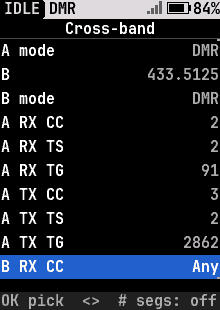 | 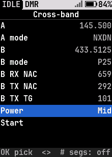 | 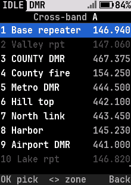 | 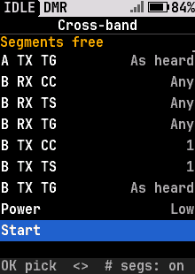 |

| Form (üst) | Soru | A'da dinleme | B'de gönderme |
| :---: | :---: | :---: | :---: |
| 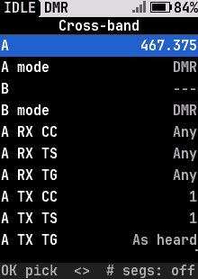 | 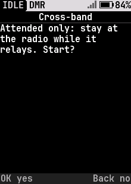 | 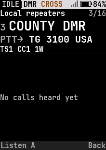 | 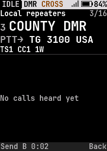 |

| Araçlar | Araçlar, diğer simgeler | Ayarlar > Tuşlar | Basılı tutma ipucu olan ana ekran |
| :---: | :---: | :---: | :---: |
| 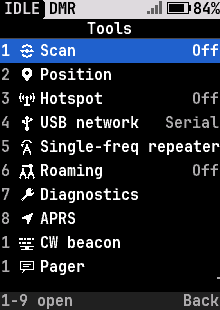 | 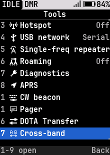 | 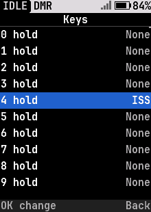 | 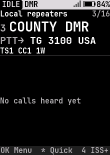 |

| Havalimanları | Deniz VHF |
| :---: | :---: |
|  | 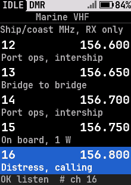 |

| Son çağrılar | APRS istasyonu | Hakkında: veri paketleri | DOTA frekansı |
| :---: | :---: | :---: | :---: |
|  |  |  |  |

| Arama aralığı | Kanal silme | Desimal NAC |
| :---: | :---: | :---: |
|  |  |  |

*Ekran görüntüleri firmware'in kendi ekran simülatöründen, uydurma verilerle alındı (İngilizce arayüz; telsiz
varsayılan olarak Türkçe; bilgisayar UI testleri yazar). Gerçek telsiz fotoğrafları eklenecek.*

### Önce Türkçe

Arayüzün tamamı Türkçeye çevrildi (İngilizce de seçilebilir). Teknik adlar (RX, TX, NAC, VFO, …) olduğu gibi kalır.

Telsizde kullanım için kısa Türkçe kılavuz (tuşlar, bölge ve kanallar, çoklu izleme, modlar, arama, harita /
APRS / havalimanları, DOTA, veri paketleri, çapraz bant, tanılama): [`docs/kullanim-telsiz.md`](docs/kullanim-telsiz.md).

## Kurulum

Windows 10/11 için **DDM32 Plus programlayıcı**yı kullanın (başka hiçbir şey kurmanız gerekmez):

1. [Son sürümden](https://github.com/d0ukan/DDM32-Plus/releases/latest) **yalnızca** `DDM32Plus-Setup-<sürüm>.exe`
   dosyasını indirip çalıştırın (oradaki diğer dosyalar programın kendisi içindir; emekli C# programı 2.0.0'ın
   üzerine kurulur). Yalnızca sizin kullanıcınıza kurulur (yönetici izni istemez), Başlat menüsü ve masaüstü
   kısayolu oluşturur. Windows "bilinmeyen yayıncı" uyarısı verebilir (program henüz kod imzalı değil): **Ek bilgi →
   Yine de çalıştır**.
2. İlk açılışta **Türkçe** ya da **English** seçin.
3. Programlama kablosunu (CH340) takın, **Telsizi güncelle** sekmesine geçip adımları izleyin; telsizi ne zaman
   kapatıp açacağınızı program söyler. Yedekleriniz programın `backups` klasöründe durur; güncellemede ve
   kaldırmada da silinmez.

Programlayıcı telsizin yedeğini alır (ya da aynı telsizin son yedeğini kullanır), neyin değişeceğini tam olarak
gösterir, yükler (telsizin kendi codec'iyle stok yazılımdan da), kendi yedeğinizden önceki sürüme veya stok yazılıma
geri döner, imzalı güncellemeleri denetler, kendini günceller ve kendi indirdiğiniz dosyalardan bilgisayarınızda
oluşturduğu **veri paketlerini** (RadioID isimleri, hava bandı frekansları) telsize yükler. Telsizin durumu sayfası,
salt okunur canlı panel, arama günlüğü ve "kanallarım" da vardır. Rehberler: [`win/README.md`](win/README.md) ve
[`win/docs/kullanim.md`](win/docs/kullanim.md) (Windows, C#), [`rust/README.md`](rust/README.md) (çok platformlu,
Rust); telsizin kendisi için Türkçe kılavuz [`docs/kullanim-telsiz.md`](docs/kullanim-telsiz.md). Her şey
**sizin sorumluluğunuzdadır** (yukarıdaki sorumluluk reddine bakın).

Eski Python programı ([`pc/`](pc/)) çalışmaya devam eder; `%LOCALAPPDATA%\DDM32Plus` (ya da `DDM25Plus`)
içindeki yedekleri yeni programlar da bulur.

## Geliştirilmekte olanlar

- DOTA Transfer'in (kanallar ve veri paketleri) ve Çapraz bant'ın iki telsizle denenmesi, ayrıca 1.0.2 - 1.0.4'ün
  telsizde denenmesi (telsiz test satırları [`docs/plus-radio-test.md`](docs/plus-radio-test.md) içinde).
- Çok platformlu programın Linux (AppImage, .deb) ve macOS paketleri.

## Derleme

Derleme upstream'in [`BUILD.md`](BUILD.md) dosyasını izler (csky-elf araç zinciri, sabitlenmiş kaynaklar).
DDM32 Plus şunları ekler:

```sh
python3 tools/build_radiofoundry.py --plus --stack-check --verify-rebuild           # DDM32 Plus
python3 tools/build_radiofoundry.py --plus --public --stack-check --verify-rebuild  # aynı imaj (RadioID veritabanı bir veri paketidir)
make test
```

Özellik notları, RAM bütçesi ve tasarım kararları: [`docs/plus.md`](docs/plus.md).

## Lisans ve teşekkür

- Upstream dosyaları (RadioFoundry, Open25-DM32) **MIT**; DDM32 Plus eklemeleri **GPL-3.0-or-later**; bir DDM32 Plus
  firmware imajı GPL-3.0-or-later altında dağıtılır. Ayrıntılar: [`LICENSING.md`](LICENSING.md).
- Üçüncü taraf kod ve veriler, koşullarıyla: [`THIRD_PARTY.md`](THIRD_PARTY.md) — RadioFoundry, Open25-DM32,
  FreeRTOS, DM32-nxdn-p25, MMDVMHost, dsdcc, Natural Earth, GeoNames (CC BY 4.0), OurAirports, RadioID.net, TRAC,
  CelesTrak.
- Bu çalışmanın üzerine kurulduğu RadioFoundry ve Open25-DM32 geliştiricilerine çok teşekkürler.
